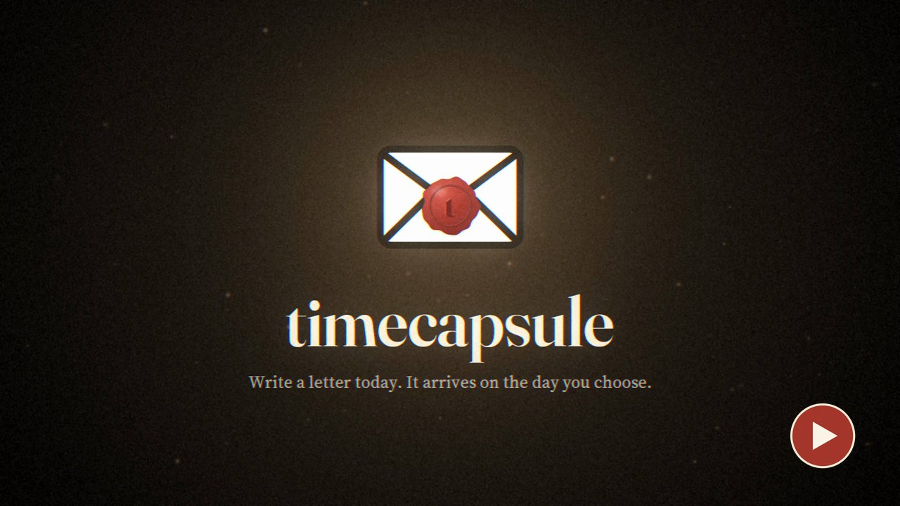
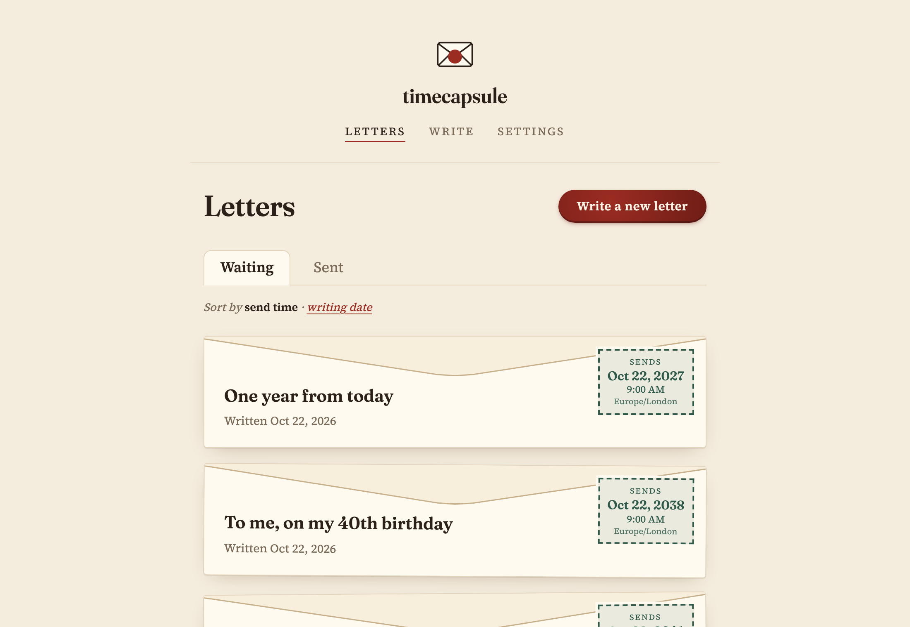
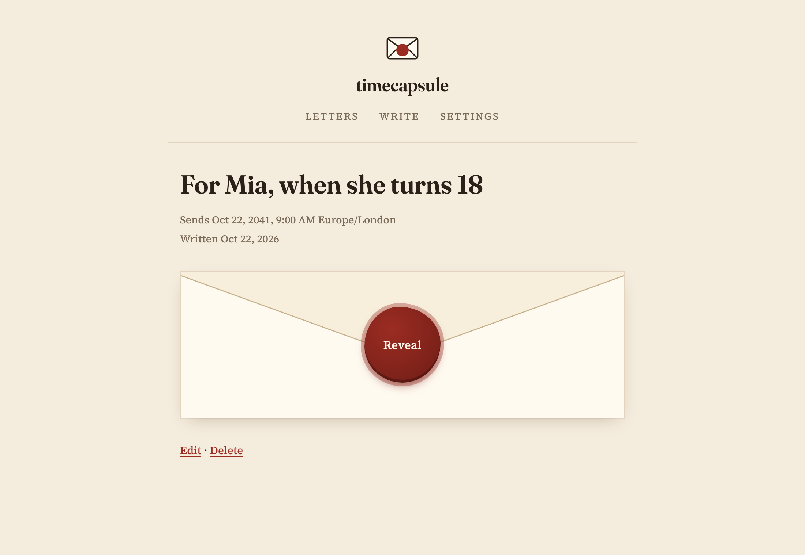
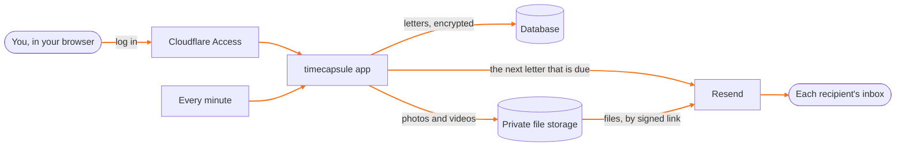

# timecapsule

Write a letter today. It arrives by email on the day you choose, a year or twenty years from now, with its photos and videos.

timecapsule is a self-hosted alternative to [FutureMe](https://www.futureme.org/). It runs on your own Cloudflare account, on Cloudflare's free plans, so there is no subscription and nobody else holds your letters.

[](https://youtu.be/T1ZPPtAJERA)

| Your letters, each sealed until its day | A waiting letter stays sealed until you reveal it |
| --- | --- |
|  |  |

## What it does

- Write a letter, add photos, videos or PDFs, and pick the date and hour it is sent, in any time zone.
- Send it to yourself, and to up to 20 other people.
- Waiting letters stay sealed, so they still surprise you. Reveal one if you want to read it early.
- Change a letter for 48 hours after writing it. After that it is locked, as a letter in the post would be.
- Export every letter and file as one zip, any time.
- Get an email if a letter could not be sent, and a short monthly summary, if you switch them on.

## How it works



1. You log in with your email address. Cloudflare Access sends you a code; only your address gets in.
2. You write the letter in your browser. The app encrypts its text, subject, recipients and file names with a key only your app holds, and keeps the files in private storage on your account.
3. Every minute the app checks for a letter that is due and hands it to Resend, which emails it to everyone on it. Resend fetches the files itself through signed links that expire after 25 hours.

All of it is one small Cloudflare Worker with a D1 database and an R2 bucket. It has one runtime package ([marked](https://github.com/markedjs/marked), for Markdown) and no framework.

## Built for Cloudflare's free plan

A Worker on the free plan gets about 10 ms of computing time per request. The app is shaped around that:

- **Your browser does the heavy work.** It turns your Markdown into clean HTML before saving, so the server only encrypts and stores it.
- **Files never pass through the app when a letter is sent.** Building a 25 MB email inside the Worker took 50–60 ms on a local test run. Instead, Resend fetches each file from storage through a signed link.
- **One letter per minute.** Each check sends at most one letter, so every run stays small. Five letters due at 9:00 go out from 9:00 to 9:04.
- **No paid add-ons.** No paid Workers plan, no queues, no external database.

On the free plans, timecapsule uses:

- 1 of the 5 scheduled tasks Cloudflare allows per account.
- 1,440 of the 100,000 Worker runs Cloudflare allows a day, for the send check.
- 1 of Resend's 100 free emails a day for each person a letter goes to. A letter to you and 20 others uses 21.

## What it costs

Nothing to run, inside the free plans. You need:

- **A Cloudflare account.** Zero Trust, which handles the login, asks for a payment card even on its free plan; R2 storage very likely does too. Nothing is charged while you stay inside the free plans.
- **A domain you own**, to send letters from. It does not have to be on Cloudflare. If you do not have one, this is the one thing you pay for.
- **A Resend account**, on its free plan. Resend sends the emails.

Staying inside the free plans is up to you. The app does not stop you from storing more than R2's free allowance.

## Privacy

- Your letters live on your own Cloudflare account. Nobody else runs a server in between.
- Letter text, subjects, recipients' addresses and file names are encrypted with a key that only your app holds, as a Cloudflare secret.
- Photos and videos are kept in a private storage bucket on your account. The app does not encrypt them; Cloudflare encrypts all stored data on its side.
- Only your email address can log in. Cloudflare Access checks the login, and the app checks it again on every request.
- When a letter is sent, Resend and each recipient's email provider see it, as with any email.
- This does not protect you from Cloudflare itself. The app, its key and your letters all run on Cloudflare, so Cloudflare could read them.

The full list of what timecapsule protects and what it does not is in [docs/security.md](docs/security.md). To report a security problem, see [SECURITY.md](SECURITY.md).

## Install

Three parts: get your accounts ready, install the app, then finish setup on the app's own page.

### 1. Get ready

1. Switch Zero Trust on: open the [Zero Trust dashboard](https://one.dash.cloudflare.com/), pick a team name and the Free plan. Note the team name; setup asks for it.
2. Switch R2 on: open [R2](https://dash.cloudflare.com/?to=/:account/r2/overview) in the Cloudflare dashboard and follow its steps.
3. In Resend, add your domain and add the DNS records Resend lists (SPF, DKIM and the bounce MX). If the domain is on Cloudflare, Resend's "Sign in to Cloudflare" button adds them for you. Add a DMARC record too. Wait until Resend shows the domain as verified.
4. In Resend, create an API key with sending access.

### 2. Install the app

Pick one way.

**With a coding agent.** Give a coding agent, such as Claude Code, this prompt:

```text
Install timecapsule from https://github.com/mdeligoz/timecapsule on my Cloudflare account with Wrangler. Follow AGENTS.md in that repository.
```

The agent makes the database and the storage bucket and deploys the app. When it is done, it gives you your app's address.

**From the command line.** You need Node.js 24 or newer, and git.

1. Get the code and its packages, and log in to Cloudflare. A browser opens for you to approve the login.

   ```sh
   git clone https://github.com/mdeligoz/timecapsule.git
   cd timecapsule
   npm ci
   npx wrangler login
   ```

2. Make the database and the storage bucket. `CI=true` stops Wrangler from editing `wrangler.jsonc`, which finds both by their name.

   ```sh
   CI=true npx wrangler d1 create timecapsule
   CI=true npx wrangler r2 bucket create timecapsule
   ```

3. Deploy. This sets up the database, then deploys the app and prints its address. Wrangler asks before it changes the database; answer yes.

   ```sh
   npm run deploy
   ```

### 3. Finish setup

1. Open your app at its address, `https://timecapsule.<your-subdomain>.workers.dev`. The setup page has four steps:
   - Save your encryption key in your password manager. It is shown only once.
   - Type your email address (only you can log in, and every letter is also sent to you), your domain verified at Resend, and paste your Resend API key.
   - Paste your Zero Trust team name.
   - Open Cloudflare's token page from the link, click Continue to summary, then Create Token, and paste the token.
2. Setup then makes your login and the storage key, stores them, deletes the token and switches itself off. The login takes up to 3 minutes to start working, so the finished page counts down and then turns on Open timecapsule; Cloudflare emails you a code to log in.

> [!WARNING]
> Never change the encryption key. Letters locked with the old key can no longer be opened. If the app is ever deleted and deployed again, its setup page asks for the key you saved and brings your letters back; [AGENTS.md](AGENTS.md) has the steps.

## Updating

Updates only ever go to a tagged release. Ask your coding agent to update timecapsule following [AGENTS.md](AGENTS.md), or run its Update steps yourself from your copy's folder. Your letters, settings and secrets are kept.

## Limits

- Send time: a date and a whole hour, at least 7 days and at most 20 years after writing.
- Recipients: you plus up to 20 others.
- Files: up to 25 MB per letter in total; JPG, PNG, GIF, WebP, HEIC, MP4, MOV and PDF.
- Text: up to 50,000 characters.
- Editing: for 48 hours after writing, then the letter is locked. Deleting: any time.

## Development

Node.js 24. Install scripts are switched off in `.npmrc`.

```sh
npm ci
npm run typecheck
npm run lint
npm test
npm run test:browser
```

The browser tests need `npx playwright install chromium` once.

## License

[MIT](LICENSE). timecapsule is not affiliated with FutureMe.
